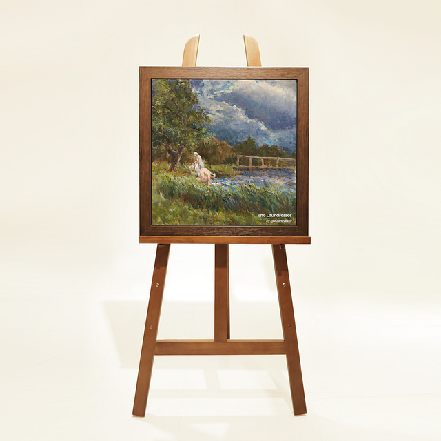

# BBuzzCanvas Cover Kiosk

[🇩🇪 Deutsch](README.md) · 🇬🇧 English


Android 5.1-compatible kiosk app that turns a BBuzzCanvas into an additional full-screen cover display for the **OnRadio Cover Bridge** project.

The app only shows the cover page provided by the Raspberry Pi, in full screen.

<br>
<a href="https://www.buymeacoffee.com/thoralf.brandt" target="_blank">
  
</a>
<br>

## BBuzzCanvas



The BBuzzCanvas is used as an additional display. The actual radio, cover and metadata logic runs on the Raspberry Pi.

Backend project:

https://github.com/TBR-BRD/onradio-cover-bridge

## Recommended URL

For the BBuzzCanvas used here, this URL is intended:

```text
http://<PI-IP>:8080/cover?rotate=left&overlay=1
```

Meaning:

- `rotate=left` rotates the display to match how the BBuzzCanvas is mounted.
- `overlay=1` shows artist and title subtly in the bottom right corner.

Without overlay:

```text
http://<PI-IP>:8080/cover?rotate=left
```

Without rotation and overlay:

```text
http://<PI-IP>:8080/cover
```

## Features

- Android 5.1 compatible
- Full-screen / immersive kiosk
- Status and navigation bar hidden
- Screen stays on
- Cover URL configurable on first start
- URL can be changed later by long-pressing the display
- Automatic reconnect on loading errors
- Autostart after Android boot
- No private IP address hard-coded in the source
- Shows the current album cover
- Optional artist/title overlay via the web interface
- No APK change needed when the overlay on the `/cover` page changes

## How it works

```text
                    Wi-Fi / LAN
                        |
                        v
             +----------------------+
             |    Raspberry Pi 3    |
             |  OnRadio Cover Bridge|
             |----------------------|
             | FastAPI web server   |
             | Cover resolution     |
             | Metadata             |
             | Cover proxy          |
             +----------+-----------+
                        |
                        | HTTP
                        v
             +----------------------+
             |     BBuzzCanvas      |
             |      Android 5.1     |
             |----------------------|
             | BBuzz Cover Kiosk    |
             | Android WebView      |
             | Full screen          |
             +----------------------+
```

The Android app itself contains no radio or cover logic. It only loads the configured URL of the Raspberry Pi.

## First setup

1. Copy the APK to the BBuzzCanvas.
2. Allow installation from unknown sources if Android asks.
3. Install the APK.
4. Start the **BBuzz Cover** app.
5. Enter the cover URL:

```text
http://<PI-IP>:8080/cover?rotate=left&overlay=1
```

6. Save.
7. The cover page is shown in full-screen mode.

## Changing the URL later

**Long-press** the displayed cover.

The URL configuration opens again.

## Installing the APK

The APK built by GitHub Actions is usually called:

```text
app-debug.apk
```

It can be transferred to the BBuzzCanvas via, for example:

- USB stick
- SD card
- Android file manager
- ADB

### Installing via ADB

If ADB is available:

```bash
adb install -r app-debug.apk
```

Start the app:

```bash
adb shell monkey -p de.onradio.bbuzzcover 1
```

## Building the APK without Android Studio

No Android Studio is needed for the build.

The repository contains a GitHub Actions workflow:

```text
.github/workflows/build-apk.yml
```

After a push to `main`, the build starts automatically.

On GitHub:

```text
Actions
→ Build Android APK
→ successful build
→ Artifacts
→ BBuzzCanvasCoverKiosk
```

Download and unzip the artifact.

It contains the APK:

```text
app-debug.apk
```

## Pushing to GitHub

Commit changes locally and upload them:

```bash
git status
git add .
git commit -m "Update BBuzzCanvas Cover Kiosk"
git push
```

## Project structure

```text
BBuzzCanvasCoverKiosk/
├── .github/
│   └── workflows/
│       └── build-apk.yml
├── app/
│   ├── build.gradle
│   └── src/
│       └── main/
│           ├── AndroidManifest.xml
│           ├── java/
│           │   └── de/onradio/bbuzzcover/
│           │       ├── MainActivity.java
│           │       └── BootReceiver.java
│           └── res/
│               └── values/
│                   ├── strings.xml
│                   └── styles.xml
├── docs/
│   └── media/
│       └── bbuzzcanvas.png
├── build.gradle
├── gradle.properties
├── settings.gradle
└── README.md
```

## Connection to the OnRadio Cover Bridge

The `/cover` web page, the album cover, artist and title are provided by the Raspberry Pi project:

https://github.com/TBR-BRD/onradio-cover-bridge

Important endpoints:

| Function | URL |
| --- | --- |
| Cover | `http://<PI-IP>:8080/cover` |
| Cover rotated | `http://<PI-IP>:8080/cover?rotate=left` |
| Cover + overlay | `http://<PI-IP>:8080/cover?rotate=left&overlay=1` |
| Status API | `http://<PI-IP>:8080/api/state` |

## Privacy

- No private IP addresses should be stored in the public repository.
- Example URLs therefore use `<PI-IP>`.
- Don't store passwords, tokens or credentials in the repository.
- Device-specific settings are stored locally on the BBuzzCanvas.

## License / third-party content

Your own project files can be published under a suitable open-source license.

The BBuzzCanvas, third-party logos, album covers, station names and other media content are subject to the rights of their respective owners.
